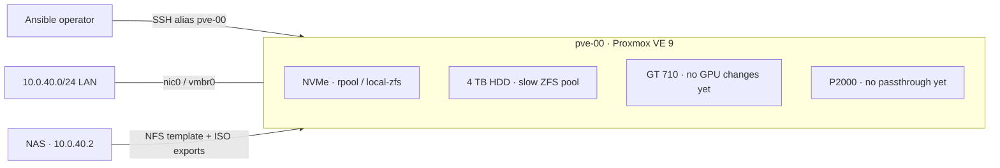

# Standalone Proxmox VE host

This repository manages **one** Proxmox VE 9 host, `pve-00`. No cluster, Ceph, Beszel agent, HA, or backup jobs are configured. The installer-provided `vmbr0`, `local`, and `local-zfs` are retained; the HGST HDD is the `slow` ZFS pool. The NAS at `10.0.40.2` supplies template and ISO exports only. No backup NFS share is mapped; PBS may be configured later.

## Layout



The diagram shows the desired storage layout; GPU configuration is deferred. A [standalone self-contained diagram](docs/layout.html) is also available for offline viewing. See [storage details](docs/storage.md) for disk identities and content assignments.

## Deferred GPU passthrough

The P2000 (`0000:02:00.0`) currently reports `boot_vga=1`, while the GT 710 (`0000:05:00.0`) reports `boot_vga=0`. **GPU configuration is commented out in `site.yml`; the current apply does not enable IOMMU or VFIO, change GPU drivers, or require a firmware setting change.** Before enabling the GPU role in a later apply, select the GT 710 as firmware primary display, reboot, and confirm:

```sh
ssh pve-00 'cat /sys/bus/pci/devices/0000:05:00.0/boot_vga /sys/bus/pci/devices/0000:02:00.0/boot_vga'
# Expected lines: 1, then 0.
```

Once re-enabled, the passthrough role refuses to apply unless the GT 710 reports `boot_vga=1`. The P2000 graphics and audio functions share IOMMU group 35 with **no other devices**; the GT 710 and its audio function share separate group 37. These were observed on the fresh host and should be rechecked if hardware changes. Details: [GPU passthrough notes](docs/gpu-passthrough.md).

## Playbook and roles

`site.yml` selects the single `pve` inventory host, checks its Debian version, and composes the roles in order:

1. `roles/proxmox_updates/` — disable subscription-only sources, enable no-subscription PVE, upgrade packages. Repository URL and suite are in `defaults/main.yml`.
2. `roles/proxmox_storage/` — verify the HDD identity, create/register the `slow` pool if absent. Disk WWN, expected serial and pool name are in `defaults/main.yml`.
3. `roles/proxmox_nfs/` — register the NAS template and ISO exports with Proxmox content restrictions. Server, exports and content are in its defaults; no backup NFS export is mapped.
4. `roles/proxmox_gpu_passthrough/` — retained for later, **commented out in `site.yml`**. PCI IDs are in its defaults; enabling it requires the GT 710 firmware display prerequisite above.

Each role owns its tasks and defaults. `site.yml` does not duplicate their implementation. Use `ansible-playbook -i inventory site.yml --check --diff --tags nfs` (or `--tags storage` / `--tags updates`) for a focused preview; `task plan` previews all active roles.

## What Ansible changes

- Removes subscription-only PVE and unused Ceph APT sources; adds the official `pve-no-subscription` repository for Debian trixie; updates APT metadata and performs a distribution upgrade. No Ceph installation or Ceph storage configuration.
- Retains existing `local-zfs` (`rpool/data`) on the NVMe and `slow` on the HGST HDD for VM/container disks. On a fresh host without `slow`, the storage role creates it by **erasing the entire matching HDD**. `local` on the NVMe remains available for ISOs/templates/backups.
- Adds `nfs-proxmox-template` (`/proxmox-template`: `vztmpl,images`) and `nfs-proxmox-iso` (`/proxmox-iso`: `iso,import`) from `10.0.40.2`. VM templates use Proxmox `images` content, which also permits ordinary VM disks. Does not mount `/proxmox-backup` or configure PBS.
- GPU role is retained but **not invoked**. No GPU passthrough or host console change is performed.
- Never reboots automatically during `task apply`. The separate operator-run `task reboot` uses Ansible's reboot module and waits for Proxmox and SSH to return. No role installs a guest VM, backup jobs, agent, or cluster services.

## Plan → apply → verify

Requires local Ansible and Task (`task`), working root SSH via the `pve-00` alias, and a trusted SSH host key. From the repository root:

```sh
ansible-playbook -i inventory site.yml --syntax-check
task plan       # check mode + diff; no host configuration applied
# Review the plan; on a fresh host lacking slow, creation wipes the HDD:
task apply      # operator-run, modifies the host
# If updates require a reboot, in a maintenance window:
task reboot     # reboots pve-00; waits for Proxmox and Ansible reconnect
```

Check mode previews file changes but cannot create or mount new storage. On this host `slow` already exists; on a fresh replacement host creating it **erases the entire matching HDD**. Package candidates can change when the no-subscription repository is refreshed during apply. `task reboot` is independent of `task apply`, waits up to 15 minutes for the host to return, then verifies Ansible connectivity. It intentionally is not run in a check-mode plan.

After apply, verify with `ssh pve-00 'zpool status; pvesm status; pvesm list nfs-proxmox-template; pvesm list nfs-proxmox-iso'`. The NFS exports should be active. A single-disk pool has **no redundancy**; keep independent backups. The P2000 remains assigned to its current host driver; do not assign it to a guest yet.
