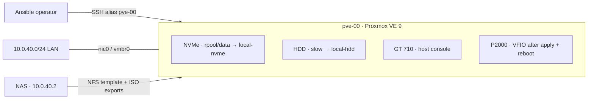

# Standalone Proxmox VE host

This repository manages **one** Proxmox VE 9 host, `pve-00`. No cluster, Ceph, Beszel agent, HA, or backup jobs are configured. The installer-provided `vmbr0` and default file storage `local` remain untouched. Proxmox ZFS storage IDs are `local-nvme` and `local-hdd`; the underlying pools remain `rpool/data` and `slow`. The NAS at `10.0.40.2` supplies template and ISO exports only. No backup NFS share is mapped; PBS may be configured later.

## Layout



The diagram shows storage allocation; the P2000 role is now enabled in Ansible, but passthrough takes effect only after the operator runs apply and reboots. A [standalone diagram](docs/layout.html) is also available for offline viewing. See [storage details](docs/storage.md) for disk identities and content assignments.

For physical upgrades, see the [motherboard allocation diagram](docs/motherboard.html): the operator-confirmed CPU-side order of the five PCIe positions is empty → NVMe → P2000 → GT 710 → empty. It also records CPU and DIMM occupancy. The empty connectors' electrical widths remain to be checked against their board labels.

## GPU passthrough

The BIOS selects the GT 710 as primary display (`0000:02:00.0`, `boot_vga=1`); the P2000 (`0000:5b:00.0`, `boot_vga=0`) is the guest GPU. **The GPU role is enabled in `site.yml`** and checks these assumptions before making changes. The P2000 graphics and audio functions share isolated IOMMU group 2; the GT 710 functions are in group 36. On `task apply` the role prepares IOMMU and VFIO, then the operator must run `task reboot` separately. Verify the P2000 uses `vfio-pci` and the GT 710 retains its host driver before assigning a guest. See [GPU passthrough notes](docs/gpu-passthrough.md).

## Playbook and roles

`site.yml` selects the single `pve` inventory host, checks its Debian version, and composes the roles in order:

1. `roles/proxmox_updates/` — disable subscription-only sources, enable no-subscription PVE, upgrade packages. Repository URL and suite are in `defaults/main.yml`.
2. `roles/proxmox_storage/` — verify the HDD identity, create `slow` ZFS pool if absent, register descriptive Proxmox IDs `local-nvme` and `local-hdd`. Disk WWN, expected serial, pool and storage names are in `defaults/main.yml`. The default `local` ID is never changed.
3. `roles/proxmox_nfs/` — register the NAS template and ISO exports with Proxmox content restrictions. Server, exports and content are in its defaults; no backup NFS export is mapped.
4. `roles/proxmox_gpu_passthrough/` — verifies GPU identity and firmware primary display, enables Intel IOMMU, and prepares selective VFIO binding for the P2000. PCI IDs are in its defaults.

Each role owns its tasks and defaults. `site.yml` does not duplicate their implementation. Use `ansible-playbook -i inventory site.yml --check --diff --tags gpu` (or `--tags nfs` / `--tags storage` / `--tags updates`) for a focused preview; `task plan` previews all active roles.

## What Ansible changes

- Removes subscription-only PVE and unused Ceph APT sources; adds the official `pve-no-subscription` repository for Debian trixie; updates APT metadata and performs a distribution upgrade. No Ceph installation or Ceph storage configuration.
- Migrates the empty Proxmox ZFS storage IDs `local-zfs` → `local-nvme` and `slow` → `local-hdd`, retaining the ZFS pools `rpool/data` and `slow` and all underlying data. Refuses to rename a storage with VM/CT volumes or a conflicting new ID. On a fresh host without the `slow` pool, creates it by **erasing the entire matching HDD**. Default `local` on the NVMe remains unchanged.
- Adds `nfs-proxmox-template` (`/proxmox-template`: `vztmpl,images`) and `nfs-proxmox-iso` (`/proxmox-iso`: `iso,import`) from `10.0.40.2`. VM templates use Proxmox `images` content, which also permits ordinary VM disks. Does not mount `/proxmox-backup` or configure PBS.
- Prepares passthrough for the P2000 graphics and audio functions only, without globally blacklisting the GT 710's driver. Changes become active after a separate reboot; no VM is created.
- Never reboots automatically during `task apply`. The separate operator-run `task reboot` uses Ansible's reboot module and waits for Proxmox and SSH to return. No role installs a guest VM, backup jobs, agent, or cluster services.

## Plan → apply → verify

Requires local Ansible and Task (`task`), working root SSH via the `pve-00` alias, and a trusted SSH host key. From the repository root:

```sh
ansible-playbook -i inventory site.yml --syntax-check
task plan       # check mode + diff; no host configuration applied
# Review the plan; on a fresh host lacking the slow ZFS pool, creation wipes the HDD:
task apply      # operator-run, modifies the host
# Reboot after GPU/IOMMU changes, in a maintenance window:
task reboot     # reboots pve-00; waits for Proxmox and Ansible reconnect
```

Check mode previews the Proxmox ZFS storage ID changes but does not perform them. Both currently contain no VM/CT volumes; if volumes are added before apply, the rename aborts. The underlying pools are not renamed. On a fresh replacement host, creating `slow` **erases the entire matching HDD**. Package candidates can change when the no-subscription repository is refreshed during apply. `task reboot` is independent of `task apply`, waits up to 15 minutes, then verifies Ansible connectivity.

After apply, verify with `ssh pve-00 'zpool status; pvesm status; pvesm list local-nvme; pvesm list local-hdd'`. Expect `local` to retain its default name and the two ZFS storages to use the new names. A single-disk pool has **no redundancy**; keep independent backups. After the separate reboot, verify both P2000 functions use `vfio-pci` and the GT 710 does not (commands in [GPU passthrough notes](docs/gpu-passthrough.md)); do not assign the GPU to a guest before that check.
